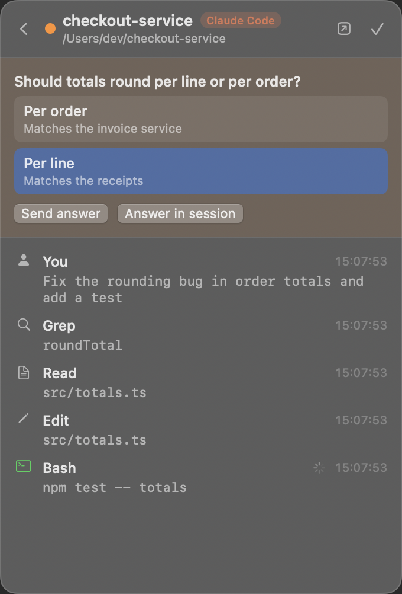

# Agent Huddle

A small always-on-top macOS widget that keeps an eye on every coding agent you have running
(**Claude Code**, **Codex** and **Cursor**), so you can see what each one is doing and answer
it without hunting for the right window.

<p>
  
  
</p>

- **One glance:** a pill in the corner with a dot per agent: green working, orange needs
  you, blue waiting for your next message, grey ended.
- **Step by step:** click a session to see its prompts, tool calls and results as they
  happen.
- **Stays out of your way:** when an agent needs you, the pill shows a short note
  ("api: allow Bash?") for a few seconds. It never pops open, plays sounds, or takes
  keyboard focus from the window you're working in.
- **Priority list:** sessions waiting on you are listed first, with what they're waiting
  for; then working, then idle, then ended.
- **Answer from the widget:** open a session to allow or deny its request or answer its
  question, without switching apps.
- **Jump or cross off:** open the session it came from, or tick it off when you're done.

<p>
  
  
</p>

## Supported agents

| | Claude Code | Codex | Cursor |
|---|---|---|---|
| Sessions and timeline | ✅ | ✅ | ✅ (tools appear once they finish) |
| Allow / deny from the widget | ✅ only for actions it would ask you about | ✅ only for actions it would ask you about | Opt-in with `--approvals`: every shell command and MCP call |
| Answer its questions | ✅ | Shown as "needs you"; answer in Codex | Not visible to hooks |
| Jump to the session | Desktop app: the exact session · Herdr: the exact tab · Terminal/iTerm: the exact tab | Codex app: the exact thread · Terminal/iTerm: the exact tab | The Cursor window with the project open |

Why the differences: Claude Code and Codex fire a hook only when they're about to show
their own approval prompt, so the widget sees exactly the prompts you would. Cursor's hooks
run before *every* shell command and MCP call, with no way to tell which ones Cursor would
have asked about, so Cursor approvals are off unless you turn them on. Codex and Cursor
don't let a hook answer their questions.

Only Claude Code has been tested end to end with the real app. The Codex and Cursor
adapters follow their published hook formats (checked November 2026) and are tested with
recorded-format events. Bug reports from real use are welcome.

## How it works

```
agent ──hook──▶ huddle-hook.sh ──HTTP (127.0.0.1)──▶ Agent Huddle.app
      ◀──reply in the agent's own format────────────┘
```

Each agent's hooks run `hooks/huddle-hook.sh --agent <name>`, which posts the event to the
widget on `127.0.0.1:47821`. The server listens on loopback only and checks a random token
created on first run in `~/.agent-huddle/headers`. A small adapter per agent
(`Sources/AgentHuddle/*Adapter.swift`) turns the agent's events into the widget's and
writes replies in that agent's format.

- **Activity** events only update the widget and return at once.
- **Permission requests** and **questions** keep the hook open until you decide.
- **No widget, no change:** if the app isn't running, the hook prints each agent's
  "carry on as normal" reply and the agent behaves as if Agent Huddle weren't there.

## Safety

- **Clicks only:** a prompt is decided only by a real mouse click on Allow, Deny or Send
  answer. The click must come at least 0.7 s after the card appeared, so a card that
  appears under your pointer can't be approved by accident. Anything else is ignored and
  logged.
- **Handing back never approves.** A prompt reaches the widget only when you are *not*
  already in the app running that session. If that app is in front, or you switch to it,
  or 90 seconds pass with no answer, the prompt goes back to the agent's own dialog. It
  never moves while your pointer is over the widget.
- **Audit trail:** every way a card leaves the widget is recorded in the session's
  timeline and in `~/.agent-huddle/huddle.log`.
- **Agents' own rules still apply:** a session in an auto-approve mode decides for itself,
  and its requests never reach the widget.

## Install

Needs macOS 13 or later and the Swift toolchain (Xcode Command Line Tools are enough).

```bash
git clone https://github.com/pritamnb/agent-huddle.git
cd agent-huddle
sh scripts/build-app.sh            # builds AgentHuddle.app
open AgentHuddle.app
```

Then add the hooks for the agents you use. Each command backs the config file up first and
keeps any hooks you already have.

```bash
python3 scripts/hooks.py install                                 # Claude Code: ~/.claude/settings.json
python3 scripts/hooks.py install --agent codex                   # Codex: ~/.codex/hooks.json
python3 scripts/hooks.py install --agent cursor                  # Cursor: ~/.cursor/hooks.json
python3 scripts/hooks.py install --agent cursor --approvals      # Cursor, with approvals
```

Codex runs new hooks only after you trust them: run `/hooks` in the Codex CLI, or open
Settings > Hooks in the Codex app.

To remove them, run the same command with `uninstall`:

```bash
python3 scripts/hooks.py uninstall --agent codex
```

Sessions appear on their next step once the hooks are installed. Drag the widget by the
grip on the pill or by the panel background; it remembers where you put it. The menu bar
icon brings it back to the corner or quits it.

## Project layout

| Path | What it does |
|---|---|
| `Sources/AgentHuddle/Adapters.swift` | The adapter interface, the event shape, and the Claude Code adapter |
| `Sources/AgentHuddle/CodexAdapter.swift` | Codex hooks to widget events, and decisions back |
| `Sources/AgentHuddle/CursorAdapter.swift` | Cursor hooks to widget events, and decisions back |
| `Sources/AgentHuddle/Server.swift` | Loopback HTTP server that holds hook connections open |
| `Sources/AgentHuddle/Store.swift` | Sessions, timelines, pending prompts and their decisions |
| `Sources/AgentHuddle/Views.swift` | SwiftUI pill, list, timeline and prompt cards |
| `Sources/AgentHuddle/Jump.swift` | Opening the window, tab or thread a session lives in |
| `Sources/AgentHuddle/main.swift` | Floating panel, menu bar item, click guard |
| `Sources/AgentHuddle/Debug.swift` | Token-guarded `/debug/*` endpoints for state, screenshots and test clicks |
| `hooks/huddle-hook.sh` | The hook relay every agent runs |
| `scripts/` | App build and hook install/uninstall |

## Adding another agent

See [CONTRIBUTING.md](CONTRIBUTING.md). An adapter is usually one Swift file plus a few
lines in the installer.

## Limits

- In VS Code, Cursor and similar editors, jump reaches the window, not the chat inside it.
  In Herdr, jump switches to the session's tab. Other terminals (Ghostty, Warp, …) are only
  brought to the front. Hover over a session's jump button to see what it will do, and every jump is logged
  in `~/.agent-huddle/huddle.log`.
- Claude desktop app sessions are matched to the app's own records to open the exact
  session and show its real title; this reads the app's local session files.
- Claude Code sessions are found from Claude Code's own records (`~/.claude/sessions`), so
  every running session is listed right away, even one started before the hooks were
  installed. Such a session shows its status and can be jumped to, but has no timeline or
  prompts until it's restarted. Codex and Cursor sessions appear on their first hook event.
- Ended sessions clear themselves after two minutes.
- Hook formats change between agent versions; the adapters target the formats published
  in November 2026.

## License

[MIT](LICENSE)
