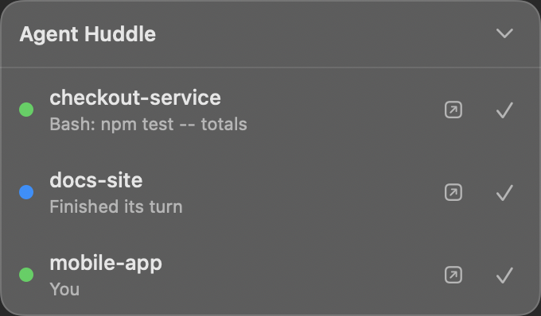
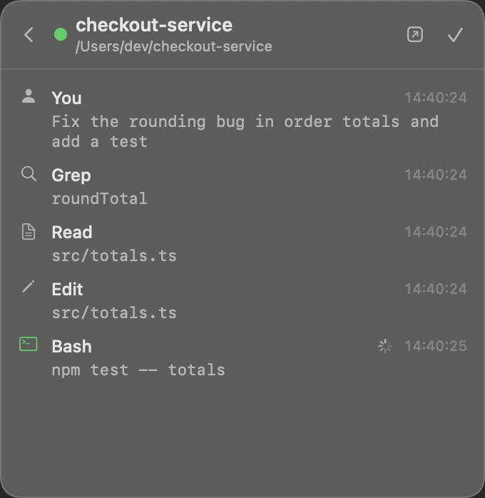
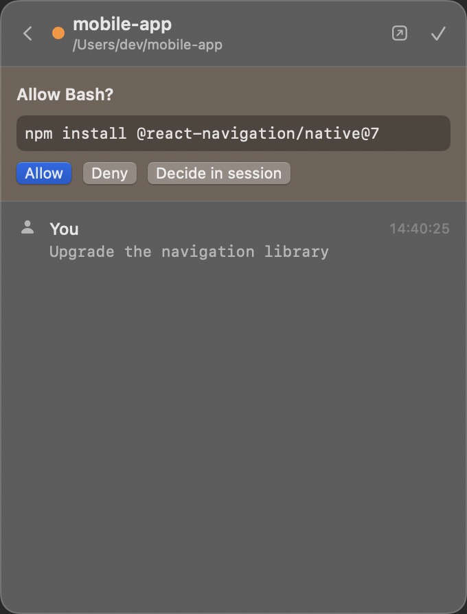

# Agent Huddle

A small always-on-top macOS widget that keeps an eye on every Claude Code session you have
running, so you can see what each agent is doing and answer it without hunting for the
right window.

<p>
  
  
</p>

- **One glance:** a pill in the corner with a dot per agent: green working, orange needs
  you, blue waiting for your next message, grey ended.
- **Step by step:** click a session to see its prompts, tool calls and results as they
  happen.
- **Answer from the widget:** allow or deny permission requests and answer Claude's
  questions without switching apps.
- **Jump or cross off:** open the exact session it came from, or tick it off when you're
  done.

<p>
  
  
</p>

## How it works

```
Claude Code ──hook──▶ huddle-hook.sh ──HTTP (127.0.0.1)──▶ Agent Huddle.app
            ◀──decision (allow / deny / answer / pass)────┘
```

Claude Code [hooks](https://code.claude.com/docs/en/hooks) run `hooks/huddle-hook.sh` on
each event. The script posts the event to the widget on `127.0.0.1:47821`. The server
listens on loopback only and checks a random token that is created on first run in
`~/.agent-huddle/headers`.

- **Activity** (`SessionStart`, `UserPromptSubmit`, `PreToolUse`, `PostToolUse`, `Stop`,
  `SessionEnd`, …) only updates the widget and returns at once.
- **Permission requests** (`PermissionRequest`) and **questions** (`PreToolUse` on
  `AskUserQuestion`) keep the hook open until you decide. The widget answers with the
  hook's documented decision JSON.
- **No widget, no change:** if the app isn't running, the hook exits silently and Claude
  Code behaves exactly as it would without it.

## Safety

- **Clicks only:** a prompt is approved only by a real mouse click on Allow, Deny or Send
  answer. The click must come at least 0.7 s after the card appeared, so a card that pops
  up under your pointer can't be approved by accident. Anything else is ignored and logged.
- **You stay in control of where prompts go:** a prompt reaches the widget only when you
  are *not* already in the app hosting that session. If that app is in front, or you
  switch to it, or 90 seconds pass with no answer, the prompt goes back to the session's
  own dialog. It never moves while your pointer is over the widget.
- **Audit trail:** every way a card leaves the widget is recorded in the session's
  timeline and in `~/.agent-huddle/huddle.log`.
- **Permission modes still apply:** sessions in Claude Code's auto mode approve tool calls
  themselves, so their requests never reach the widget.

## Jumping to a session

| Where the session runs | What jump does |
|---|---|
| Claude desktop app | Opens that exact session with the app's `claude://code/continue` link |
| Terminal / iTerm2 | Selects the exact tab, matched by its tty |
| VS Code, Cursor, Windsurf | Focuses the window with the project folder open |

## Install

Needs macOS 13 or later and the Swift toolchain (Xcode Command Line Tools are enough).

```bash
git clone https://github.com/pritamnb/agent-huddle.git
cd agent-huddle
sh scripts/build-app.sh            # builds AgentHuddle.app
open AgentHuddle.app
python3 scripts/hooks.py install   # adds the hooks to ~/.claude/settings.json, with a backup
```

Sessions appear on their next step once the hooks are installed. To remove the hooks:

```bash
python3 scripts/hooks.py uninstall
```

Drag the widget by the grip on the pill or by the panel background; it remembers where you
put it. The menu bar icon brings it back to the corner or quits it.

## Project layout

| Path | What it does |
|---|---|
| `Sources/AgentHuddle/Server.swift` | Loopback HTTP server that holds hook connections open |
| `Sources/AgentHuddle/Store.swift` | Sessions, timelines, pending prompts and their decisions |
| `Sources/AgentHuddle/Views.swift` | SwiftUI pill, list, timeline and prompt cards |
| `Sources/AgentHuddle/Jump.swift` | Opening the window or tab a session lives in |
| `Sources/AgentHuddle/main.swift` | Floating panel, menu bar item, click guard |
| `Sources/AgentHuddle/Debug.swift` | Token-guarded `/debug/*` endpoints for state, screenshots and test clicks |
| `hooks/huddle-hook.sh` | The hook relay Claude Code runs |
| `scripts/` | App build and hook install/uninstall |

## Limits

- In VS Code and similar editors, jump reaches the window, not the Claude tab inside it.
- Sessions that were already running show up on their next step, not right away.
- Ended sessions clear themselves after two minutes.
- Built and tested on macOS with Claude Code 2.1; hook formats may change between
  Claude Code versions.
